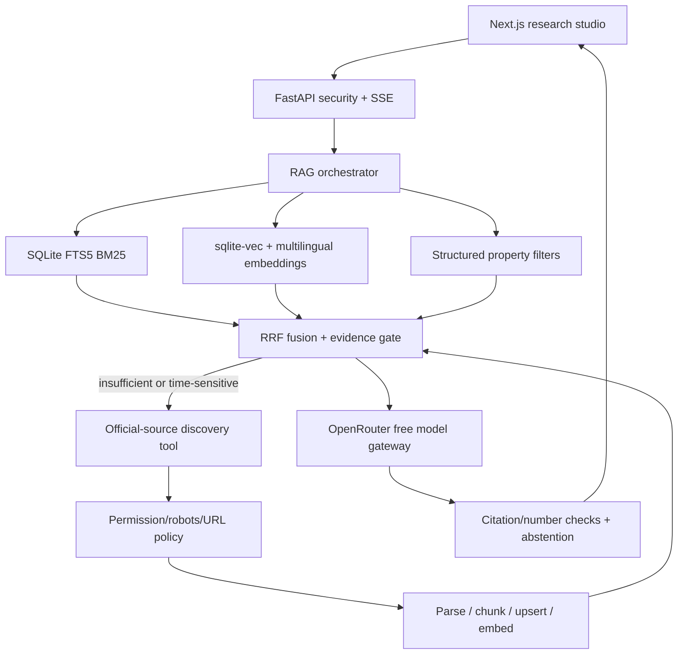

# ESTATE / INTELLIGENCE

**Real estate research studio · DarGlobal + authorized Wasalt data · Hybrid SQLite RAG · OpenRouter**

A source-grounded research application with an original editorial chat interface, evidence-first retrieval, multi-model selection, independently executable source adapters, and a single-host Docker production topology.

> **Data integrity:** The repository contains **no fabricated property records or seeded listing data**. The chatbot starts with an empty index until permitted source ingestion/import succeeds. Wasalt's published usage restrictions require documented authorization before collection. Model responses require your own OpenRouter API key; without it the API returns clearly labeled evidence-only results. No deployed public URL is supplied because this environment has no hosting account/credentials.

## Architecture



The frontend uses a custom deep-forest editorial theme with an architectural research graphic, live data counters, multi-model dropdown, source controls, activity display and citations.

## Quick start — GitHub Codespaces

1. Open this repository in a GitHub Codespace. The dev container installs Python, Node, Docker and the required tooling.
2. Copy `.env.example` to `.env` (the Makefile does this automatically if missing). Add `OPENROUTER_API_KEY` to enable actual model-generated answers. For Codespaces use a Codespaces secret, not Git commits.
3. Run **`make up`** from the repository root. Docker builds the backend and frontend, applies migrations, runs gated ingestion/indexing, starts the API/worker and opens port **3000**.
4. In the **Ports** tab, open port **3000**. Change visibility to Public only if appropriate for your security and quota policy.
5. Visit `/api/v1/health/ready` through the forwarded host to check DB/search readiness.

`make up` requires Codespaces internet access to install dependencies, download the local embedding model and call external services. The first cold build can be lengthy, depending on network and disk resources.

**Codespaces previews are not guaranteed to remain live after a Codespace stops.** See [deployment](docs/deployment.md) for persistent public hosting.

## Authorized Wasalt collection (updated adapter)

The Wasalt integration now targets its public property/category and project pages, rather than treating Wasalt like a generic corporate website. Configure the existing `.env` (do not overwrite your API key) after obtaining permission covering collection and your intended chatbot use:

```dotenv
WASALT_AUTHORIZED=true
WASALT_AUTHORIZATION_REFERENCE="Your actual authorization reference from the assessment provider"
SCRAPER_ENGINE=httpx
WASALT_DETAILS_PER_CATEGORY=3
WASALT_MAX_CATEGORY_PAGES=3
WASALT_MAX_RESPONSE_BYTES=5000000
```

Use your actual reference, not the example text above. Permission is an operator attestation; the crawler still respects robots.txt and stops on access refusals. HTTPX is the recommended first diagnostic engine; select Scrapling if its optional extra is installed.

Native verification (from repository root, existing services can be stopped while updating):

```bash
make local-scrape-wasalt ARGS="--engine httpx --max-pages 40"
make local-index
make stats
make export
make search Q="Wasalt apartments for sale in Riyadh"
make local
```

To focus the standalone scraper on a location or transaction:

```bash
make local-scrape-wasalt ARGS="--engine httpx --max-pages 20 --query 'apartments for rent in Jeddah'"
```

Docker equivalent:

```bash
make up
docker compose exec api python /app/scripts/scrape_wasalt.py --engine httpx --max-pages 40
make index
```

Existing SQLite databases remain compatible. There is no schema migration or database reset required. Keep your existing `.env` and `data/` directory (or Docker volume) when copying these source files. An empty/blocked report is not a successful collection. Inspect `failures` and `make stats`; the worker can continue pending vector indexing. See [Wasalt adapter details](docs/data-sources.md#wasalt) for scope and limitations.

## Responsive research interface

The architectural editorial theme is preserved. The conversation scrolls independently of the composer; on screens up to 1240px the source-evidence panel opens as a dismissible right drawer, and up to 900px the workspace navigation becomes a left drawer. Both have close buttons, Escape dismissal and keyboard focus containment. The model catalogue, source filters, citations and chat input remain available on mobile. To check a running UI using a real browser, follow [the browser smoke test](docs/testing.md#responsive-browser-smoke-test).

## Run without Docker — Codespaces or local Linux

Prerequisites: Python 3.12/3.13, `uv`, Node.js 22, pnpm 9, Bash, Make and curl. Codespaces already configures these. Native runs do not need a Docker daemon.

```bash
cp -n .env.example .env
# Edit .env: set OPENROUTER_API_KEY to your OpenRouter API key.
make local
```

`make local` installs Python dependencies on the first run, migrates and initializes SQLite, performs permitted startup ingestion and indexing, runs the API and scheduled worker, and launches Next.js. Open forwarded port 3000; port 8000 is the local API. Press Ctrl+C to stop. If another instance is using either port, stop that instance before launching.

Native SQLite database: **`data/estate.db`**. Model cache: `data/models-cache/`. This is separate from the Docker volume, so switching from Docker to native requires ingestion into the new database (or an explicit, safe backup/restore). No data is invented or pre-seeded. You may set `SCRAPE_ON_BOOT=false` for a quick empty-index startup, then ingest manually.

### Terminal-only workflow

```bash
make local-setup
make local-doctor
make local-check-ai
make local-scrape-darglobal
make local-index
make stats
make models
make search Q="Dubai project amenities"
make chat
make export
```

`make local-check-ai` sends a tiny direct completion request to the chosen free model, separately from RAG, and reports the HTTP status/error reason without exposing your key. It consumes one model request. `make chat` keeps recent context in memory for that terminal session; enter `/new` for a clean chat and `/exit` to end. `make chat ARGS='--question "What developments are documented in Dubai?"'` runs a single question. The site-backed API and interactive terminal chat share the same native SQLite index.

`make local-api` launches only FastAPI; `make local-ingest` refreshes permitted sources, and `make local-scrape-wasalt` requires independently documented authorization. `make export` writes real stored documents, properties and chunks to CSV/JSON under `data/exports/`, which is gitignored. Keep these exports private unless the content license permits redistribution.

If you change dependencies, rerun `make local-setup`. The native runner now detects a missing Scrapling extra even in an existing virtual environment, including an explicit `--engine scrapling` override. To enable Scrapling in native mode, set `SCRAPER_ENGINE=scrapling` and `ENABLE_SCRAPLING=true` in `.env` before setup.

### If the chatbot was returning the same answer every time

This release replaces the old repetitive evidence-only response with precise failure reasons. It gates retrieval on actual query terms and requested fields, suppresses near-duplicate chunks, attempts authorized live discovery for missing evidence, validates numeric facts against the cited excerpts, and recognizes an explicit model abstention as a valid response. Prior chat text is used only to resolve follow-up references, not as factual evidence. New research sessions have independent conversation IDs and cancel stale in-flight responses.

Run `make local-check-ai` or (Docker) `make check-ai` to isolate credentials/provider errors from retrieval. Check `make stats` and `make search Q="your question"` in native mode for missing data. In Docker use `make refresh` and `make index` to update the existing volume; don't delete the volume merely to fix an API error. See [troubleshooting](docs/troubleshooting.md).

## Optional Scrapling scraping engine

The source collection layer supports **two selectable engines**, both using the same
source authorization, robots.txt checks, URL allowlist, bounded crawl and SQLite RAG ingestion:

| Engine | Behavior | Dependency |
|---|---|---|
| `httpx` (default) | HTTPX streaming fetch + BeautifulSoup link extraction | Included |
| `scrapling` | Scrapling async `FetcherSession` HTTP fetch + native CSS link extraction | Opt-in `scrapling[fetchers]==0.5.1` |

**Enable Scrapling in GitHub Codespaces / Docker:** in `.env`, set:

```env
ENABLE_SCRAPLING=true
SCRAPER_ENGINE=scrapling
```

Run **`make up`**. The Docker build argument installs the optional Python extra,
and the environment variable selects it for scheduled ingestion, independent
source scripts and on-demand official-source discovery. Switching back to
`SCRAPER_ENGINE=httpx` doesn't require reinstalling anything. Setting
`ENABLE_SCRAPLING=false` and rebuilding excludes Scrapling from the image.

**Single script override**, within the Docker API container:

```bash
docker compose run --rm --no-deps api python /app/scripts/scrape_darglobal.py --engine scrapling --max-pages 10
```

Locally without Docker, install the optional extra before selecting the engine:

```bash
cd backend
uv sync --extra scrapling --extra dev
cd ..
bash scripts/local.sh scrape-darglobal --engine scrapling --max-pages 10
```

The Wasalt script accepts `--engine scrapling` too, but **still refuses to fetch
without documented authorization**. Scrapling does not grant collection rights.

This integration deliberately uses Scrapling's **ordinary HTTP fetcher**, not
StealthyFetcher, browser automation, CAPTCHA solving, proxies or bot evasion.
Robots/sitemaps are checked through HTTPX; Scrapling fetches and parses permitted
HTML pages. Responses are checked for type and size (Scrapling buffers the body
before this post-fetch check), and redirects are validated per hop. There is no
silent fallback to HTTPX if the selected Scrapling engine is unavailable.

A `cf-mitigated: challenge` response is recorded as `access_restricted`, not an authorization failure or property listing. Obtain approved access or a permitted data export if the site challenges requests.

See [Scrapling integration documentation](docs/scrapling.md) and the
[Scrapling repository](https://github.com/D4Vinci/Scrapling).

## Source collection

Independent scripts (from repository root):

```bash
PYTHONPATH=backend python scripts/scrape_darglobal.py --max-pages 20 --engine httpx
PYTHONPATH=backend python scripts/scrape_wasalt.py --max-pages 20 --dry-run --engine httpx
```

Docker-based equivalent after setup:

```bash
make scrape-darglobal
make scrape-wasalt
make refresh
make index
```

- DarGlobal: official-domain bounded crawl with source-specific rules, robots.txt checks and no CAPTCHA bypass. Pages may be unavailable or disallowed; the ingestion report records that condition.
- Wasalt: explicit permission gate. Requires `WASALT_AUTHORIZED=true` and a nonempty independently verifiable `WASALT_AUTHORIZATION_REFERENCE`; compliance is the operator's responsibility. Without authorization, **the script does not fetch Wasalt content** and exits with code 2.
- Authorized CSV/JSON: `PYTHONPATH=backend python scripts/import_authorized_data.py /path/to/export.json --source wasalt --authorization-reference REFERENCE`. Each record requires an official HTTPS `url`, `title`, and sufficient sourced `content` or `description`.

Do not claim that restricted Wasalt data was scraped or that the original assessment is fully complete until appropriate source permission is obtained.

## Environment variables

See `.env.example` for all settings. Important fields:

| Setting | Purpose |
|---|---|
| `OPENROUTER_API_KEY` | User-provided OpenRouter key; never sent to browser |
| `OPENROUTER_MODEL` | `openrouter/free` default |
| `FREE_MODELS_ONLY` | Must remain enabled on a free-only deployment |
| `DATABASE_URL` | SQLite file under persistent `/data` |
| `SCRAPE_ON_BOOT` | Enables gated initial refresh |
| `SCRAPER_ENGINE` | `httpx` or `scrapling` for source and live discovery fetching |
| `ENABLE_SCRAPLING` | Docker build arg that installs Scrapling optional dependencies |
| `WASALT_AUTHORIZED` | Source access gate; false by default |
| `WASALT_AUTHORIZATION_REFERENCE` | Reference to verifiable written permission |
| `EMBEDDING_PROVIDER` | `local` (default), `gemini`, `openai_compatible`, or `huggingface` |
| `EMBEDDING_API_KEY` | Server-side key for the selected HTTP embedding provider |
| `EMBEDDING_API_URL` | Optional embedding endpoint override |
| `EMBEDDING_MODEL` | Local or provider model name |
| `RAG_LIVE_SEARCH` | Enables authorized on-demand sitemap discovery |

The local CPU embedding provider is an optional dependency group. Docker Compose
and CI include it for full local compatibility; memory-constrained deployments
can select an HTTP provider and avoid installing PyTorch and SentenceTransformers.
The single-container free-tier Render setup is defined by `render.yaml` and
`Dockerfile.render`; add the `OPENROUTER_API_KEY` and `EMBEDDING_API_KEY` secrets
in Render. Gemini embeddings are selected by default there.

## CPU-only PyTorch in Docker (Codespaces build fix)

The sentence-transformers dependency requires PyTorch, but Codespaces and this
application use **CPU embedding inference**. Default Linux x86_64 PyPI PyTorch
resolution can pull several GB of NVIDIA/CUDA wheels (`nvidia-cusparse`, etc.),
causing install timeouts and excessive Docker image sizes.

`Dockerfile.api` pins uv 0.10.0 and installs the `local-embeddings` extra,
resolving PyTorch through uv's CPU backend
(on x86_64 only); ARM64 uses its CPU-only PyPI wheel. A build-time check rejects
CUDA-enabled PyTorch and `uv pip check` validates dependency consistency.
The `backend/pyproject.toml` also routes local `uv run`/`uv sync` on Linux x86_64
to the official PyTorch CPU wheel index. CI uses the same CPU path. This **does not
disable** semantic RAG or change the embedding model/vector dimensions.

After updating the repository in Codespaces, rebuild without the cached failed
layer: `docker compose build --no-cache api`, then run `make up`. CPU-only PyTorch
is still a sizable download, and access to the official PyTorch CPU index is
required; a network timeout there is not a CUDA problem.

## Packaging and optional evaluation files

The backend Dockerfile deliberately creates `/app/evaluations/retrieval` rather than copying an optional, potentially empty host directory. This keeps `make up` compatible with fresh clones and ZIP extraction (ZIP archives may omit empty folders). `make eval` mounts your local `evaluations/` directory read-only; see [`evaluations/README.md`](evaluations/README.md).

## Useful commands

| Command | Description |
|---|---|
| `make up` | Build and launch all services with migration, ingestion, indexing |
| `make down` | Stop services; **preserves** SQLite volume |
| `make logs` | Watch logs |
| `make status` | Container status |
| `make doctor` | Check configuration/vector extension |
| `make refresh` | Force eligible source refresh |
| `make scrape-darglobal` | Independently ingest DarGlobal |
| `make scrape-wasalt` | Independently run Wasalt adapter (authorization required) |
| `make index` | FTS rebuild + vector backfill |
| `make smoke-test` | Test real running HTTP endpoints |
| `make backup` | Safe SQLite backup |
| `make test` | Run backend tests |
| `make lint` | Ruff and TypeScript checks |
| `make eval` | Evaluation using real labeled indexed data only |

## Grounding and limitations

- Hybrid FTS5 + sqlite-vec search uses RRF; semantic search is disabled visibly if optional dependencies/model downloads fail.
- The local multilingual embedding model requires a one-time Hugging Face model download.
- Reranking is deliberately identity-only by default: CPU cross-encoder cost is not justified without a measured lift on an actual labeled corpus.
- Live lookup is **bounded official sitemap URL discovery**, not a general-purpose web search. If permissions, sitemap access, or evidence are insufficient the assistant abstains.
- Assistant claims use source IDs in the form `[E1]`; invalid IDs and unsupported numeric details cause evidence-only fallback. This guard does not guarantee that every qualitative statement is entailed; validate against your domain evaluation set before high-stakes use.
- The frontend streams verified text in chunks after upstream answer completion. This avoids showing unverified model tokens, at the cost of initial-token latency.
- The free OpenRouter model catalog may change; individual models are displayed only when current free pricing is confirmed.
- SQLite is intended for a single persistent host; it is not designed here for distributed multi-writer deployments.

## Documentation

- [RAG system](docs/rag-design.md)
- [Ingestion and permissions](docs/data-sources.md)
- [Scrapling engine](docs/scrapling.md)
- [Tool policies](docs/agent-tools.md)
- [SQLite model](docs/database.md)
- [API and SSE](docs/api.md)
- [Security model](docs/security.md)
- [Deployment runbook](docs/deployment.md)
- [Operations and backup/restore](docs/operations.md)
- [Testing/evaluation](docs/testing.md)

## Licensing and data rights

Application source code is offered under the MIT license. Rights to source-site content remain with its owners. Before deployment, review the source websites' current terms and secure required authorizations. This repository does not redistribute property listing content.

### Diagnose missing evidence

If chat returns `no_evidence`, run `make local-doctor`, `make local-scrape-darglobal ARGS="--engine httpx --max-pages 40"`, `make local-index`, `make search Q="DG1 Dubai amenities"`, and `make local-check-ai`. The scraper now prioritizes the official project catalogue and the live tool uses visible project-card labels to discover relevant pages. Inspect per-page `failures` and research activity for precise access/HTTP/extraction errors. No source restrictions are bypassed. See `docs/troubleshooting.md`.

## Authorized Wasalt provider (Apify)

See [docs/apify.md](docs/apify.md) for the optional Apify provider, exact configuration, dry-run/ingestion commands, billing controls, data contract and limitations. It is integrated into CLI, normal ingestion, the worker and opt-in live RAG search. HTTPX is the default Wasalt provider independently of the DarGlobal engine; Scrapling and Apify remain explicit alternatives. The research interface now shows full example questions, selected ingestion engine, source observation dates, and a dedicated conversation scroll region with a Latest message control.

## HTTPX-first Wasalt and latency tuning

This release defaults Wasalt to HTTPX, with Apify off unless explicitly enabled. Existing `.env` settings override defaults: set `WASALT_ENGINE=httpx`, `APIFY_ENABLED=false`, and `APIFY_LIVE_SEARCH=false` in your actual environment file if upgrading from the Apify edition. Keep the existing authorization, API key, SQLite file and model cache. Optional authorized Apify ingestion can still be selected by an explicit CLI flag. No automatic switch to Apify following access refusal. See [performance guide](docs/performance.md) for commands, timing breakdown, limits, and trade-offs.
