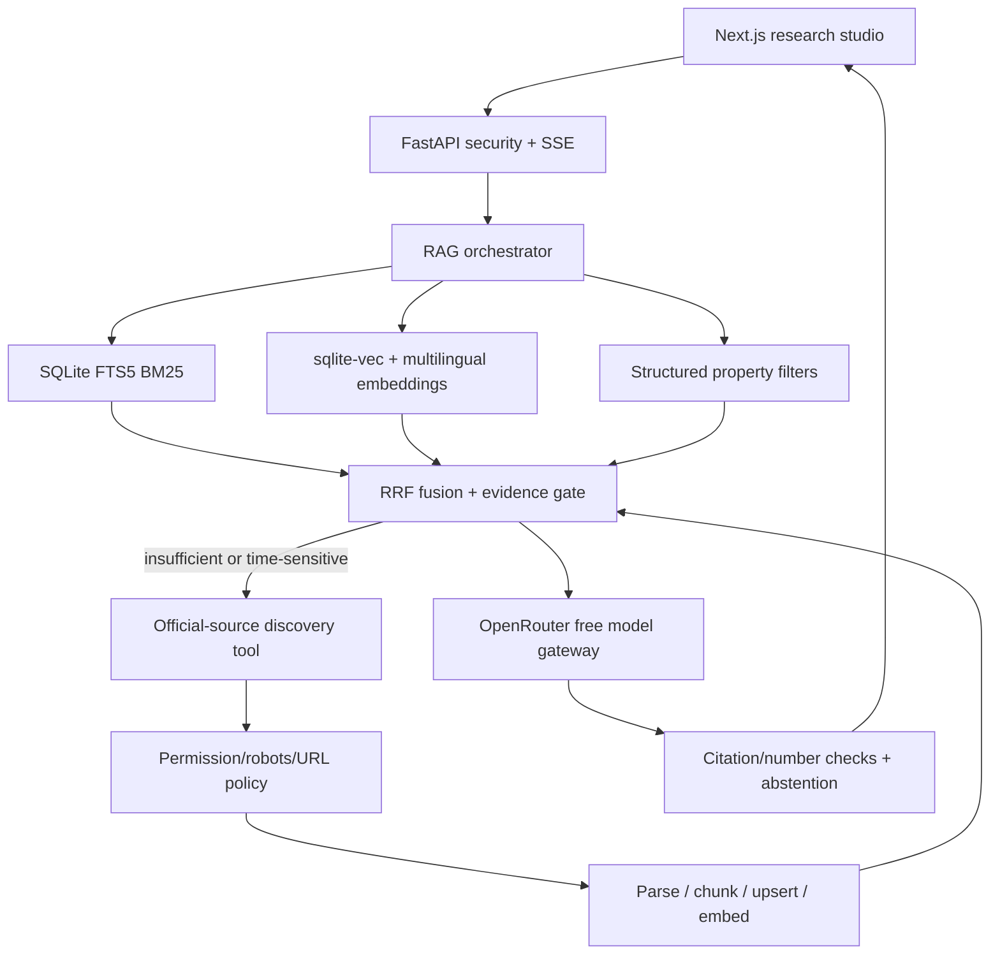

# ESTATE / INTELLIGENCE

**Real estate research studio · DarGlobal + authorized Wasalt data · Hybrid SQLite RAG · OpenRouter**

A source-grounded research application with an original editorial chat interface, evidence-first retrieval, multi-model selection, independently executable source adapters, and a single-host Docker production topology.

> **Data integrity:** The repository contains **no fabricated property records or seeded listing data**. The chatbot starts with an empty index until permitted source ingestion/import succeeds. Wasalt's published usage restrictions require documented authorization before collection. Model responses require your own OpenRouter API key; without it the API returns clearly labeled evidence-only results. No deployed public URL is supplied because this environment has no hosting account/credentials.

## Architecture



The frontend uses a custom deep-forest editorial theme with an architectural research graphic, live data counters, multi-model dropdown, source controls, activity display and citations.

## Quick start — GitHub Codespaces

1. Open this repository in a GitHub Codespace. The dev container installs Python, Node, Docker and the required tooling.
2. Copy `.env.example` to `.env` (the Makefile does this automatically if missing). Add `OPENROUTER_API_KEY` to enable actual model-generated answers. For Codespaces use a Codespaces secret, not Git commits.
3. Run **`make up`** from the repository root. Docker builds the backend and frontend, applies migrations, runs gated ingestion/indexing, starts the API/worker and opens port **3000**.
4. In the **Ports** tab, open port **3000**. Change visibility to Public only if appropriate for your security and quota policy.
5. Visit `/api/v1/health/ready` through the forwarded host to check DB/search readiness.

`make up` requires Codespaces internet access to install dependencies, download the local embedding model and call external services. The first cold build can be lengthy, depending on network and disk resources.

**Codespaces previews are not guaranteed to remain live after a Codespace stops.** See [deployment](docs/deployment.md) for persistent public hosting.

## Source collection

Independent scripts (from repository root):

```bash
PYTHONPATH=backend python scripts/scrape_darglobal.py --max-pages 20
PYTHONPATH=backend python scripts/scrape_wasalt.py --max-pages 20 --dry-run
```

Docker-based equivalent after setup:

```bash
make scrape-darglobal
make scrape-wasalt
make refresh
make index
```

- DarGlobal: official-domain bounded crawl with source-specific rules, robots.txt checks and no CAPTCHA bypass. Pages may be unavailable or disallowed; the ingestion report records that condition.
- Wasalt: explicit permission gate. Requires `WASALT_AUTHORIZED=true` and a nonempty independently verifiable `WASALT_AUTHORIZATION_REFERENCE`; compliance is the operator's responsibility. Without authorization, **the script does not fetch Wasalt content** and exits with code 2.
- Authorized CSV/JSON: `PYTHONPATH=backend python scripts/import_authorized_data.py /path/to/export.json --source wasalt --authorization-reference REFERENCE`. Each record requires an official HTTPS `url`, `title`, and sufficient sourced `content` or `description`.

Do not claim that restricted Wasalt data was scraped or that the original assessment is fully complete until appropriate source permission is obtained.

## Environment variables

See `.env.example` for all settings. Important fields:

| Setting | Purpose |
|---|---|
| `OPENROUTER_API_KEY` | User-provided OpenRouter key; never sent to browser |
| `OPENROUTER_MODEL` | `openrouter/free` default |
| `FREE_MODELS_ONLY` | Must remain enabled on a free-only deployment |
| `DATABASE_URL` | SQLite file under persistent `/data` |
| `SCRAPE_ON_BOOT` | Enables gated initial refresh |
| `WASALT_AUTHORIZED` | Source access gate; false by default |
| `WASALT_AUTHORIZATION_REFERENCE` | Reference to verifiable written permission |
| `EMBEDDING_MODEL` | CPU multilingual model |
| `RAG_LIVE_SEARCH` | Enables authorized on-demand sitemap discovery |

## Useful commands

| Command | Description |
|---|---|
| `make up` | Build and launch all services with migration, ingestion, indexing |
| `make down` | Stop services; **preserves** SQLite volume |
| `make logs` | Watch logs |
| `make status` | Container status |
| `make doctor` | Check configuration/vector extension |
| `make refresh` | Force eligible source refresh |
| `make scrape-darglobal` | Independently ingest DarGlobal |
| `make scrape-wasalt` | Independently run Wasalt adapter (authorization required) |
| `make index` | FTS rebuild + vector backfill |
| `make smoke-test` | Test real running HTTP endpoints |
| `make backup` | Safe SQLite backup |
| `make test` | Run backend tests |
| `make lint` | Ruff and TypeScript checks |
| `make eval` | Evaluation using real labeled indexed data only |

## Grounding and limitations

- Hybrid FTS5 + sqlite-vec search uses RRF; semantic search is disabled visibly if optional dependencies/model downloads fail.
- The local multilingual embedding model requires a one-time Hugging Face model download.
- Reranking is deliberately identity-only by default: CPU cross-encoder cost is not justified without a measured lift on an actual labeled corpus.
- Live lookup is **bounded official sitemap URL discovery**, not a general-purpose web search. If permissions, sitemap access, or evidence are insufficient the assistant abstains.
- Assistant claims use source IDs in the form `[E1]`; invalid IDs and unsupported numeric details cause evidence-only fallback. This guard does not guarantee that every qualitative statement is entailed; validate against your domain evaluation set before high-stakes use.
- The frontend streams verified text in chunks after upstream answer completion. This avoids showing unverified model tokens, at the cost of initial-token latency.
- The free OpenRouter model catalog may change; individual models are displayed only when current free pricing is confirmed.
- SQLite is intended for a single persistent host; it is not designed here for distributed multi-writer deployments.

## Documentation

- [RAG system](docs/rag-design.md)
- [Ingestion and permissions](docs/data-sources.md)
- [Tool policies](docs/agent-tools.md)
- [SQLite model](docs/database.md)
- [API and SSE](docs/api.md)
- [Security model](docs/security.md)
- [Deployment runbook](docs/deployment.md)
- [Operations and backup/restore](docs/operations.md)
- [Testing/evaluation](docs/testing.md)

## Licensing and data rights

Application source code is offered under the MIT license. Rights to source-site content remain with its owners. Before deployment, review the source websites' current terms and secure required authorizations. This repository does not redistribute property listing content.
