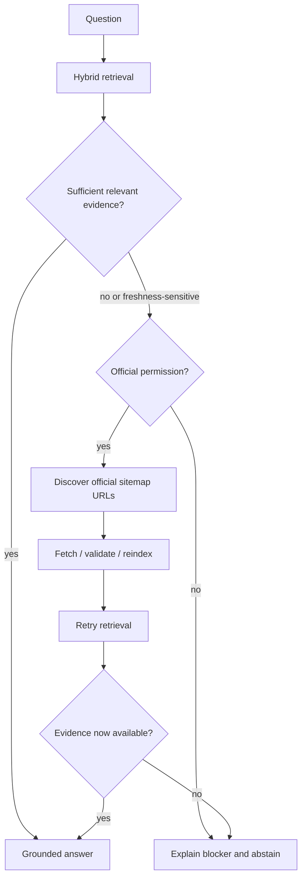

# Deterministic tool orchestration and threat boundary

The current tool architecture is owned by Python rather than the LLM. Every model receives the same permission and safety constraints, even if it does not support native function calling.

`HybridRetriever.retrieve`: structured + lexical + semantic cached search; source IDs restricted to `darglobal` and `wasalt`.

`discover_and_ingest`: searches a permitted official sitemap by comparing query tokens with URL path components, fetches only matching official URLs, validates robots and host policy, parses, persists, and reindexes up to the configured `AGENT_MAX_LIVE_PAGES`. It does not accept arbitrary URLs from a user or LLM.

`SourcePolicy.check`: verifies source enabled/authorized, HTTPS domain allowlist, public DNS resolution and robots rules. Redirects are followed only when each new URL passes the same official-host and robots permission checks. Requests cap response bytes and disable environment proxy inheritance. Network or policy failure returns status rather than circumventing the site.

Missing-evidence path:

Budget: max 3 live pages, 22-second deadline by default. No arbitrary shell, external URLs, unrestricted web search, or automatic paid tools. Rate limits apply at API boundary. The lack of a general search-provider integration is a deliberate narrow trust boundary, not a claim of universal website discovery.

## Scrapling optional engine

On-demand official sitemap discovery uses the configured `SCRAPER_ENGINE`
for eligible HTML page fetching and link extraction. It continues enforcing
robots/authorization and bounded tool limits; choosing Scrapling does not
permit bypassing site controls. See [Scrapling](scrapling.md).

Wasalt live discovery uses question-targeted public category URLs and their listing/project card links. The orchestrator narrows an explicitly source-named question to that enabled source unless the question requests a comparison. Cross-source searches reserve a bounded share of page attempts for the other enabled source. Access refusal and the existing authorization/robots checks remain authoritative.
