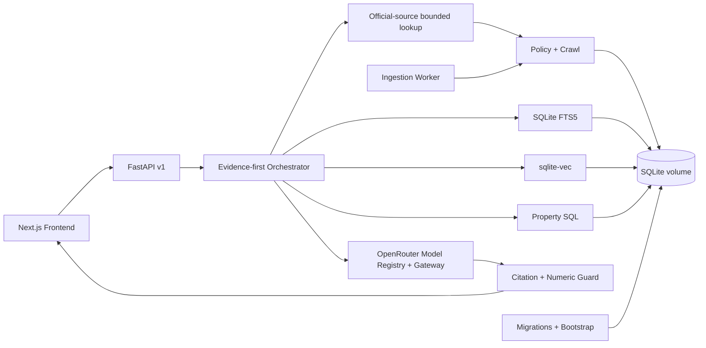

# Component architecture

Trust boundaries:

- Browser: public data only, no API keys.
- API: validates requests, sources, model IDs and conversation tokens.
- Tool worker: official host allowlist and permission checks before network access.
- Retrieved content: untrusted evidence only.
- Model response: untrusted until citation and numeric checks pass.
- SQLite: persistent on single host, no public database port.

Operational notes:

- Data ingestion and query-triggered lookup reuse the same document upsert path.
- Vector model loads lazily; missing model results in explicit degraded retrieval.
- Provider selection is dynamically read from OpenRouter catalog rather than a stale static model list.
- API returns SSE events to display verified text and actual search phases.
