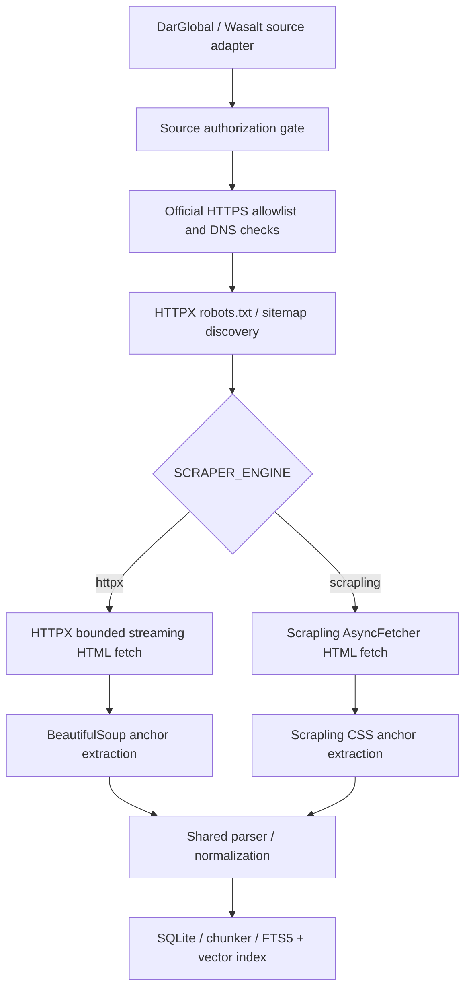

# Optional Scrapling scraping engine

## Scope and version

This project provides an **opt-in Scrapling HTTP + CSS extraction engine** next
to the existing HTTPX + BeautifulSoup path. It targets the verified Scrapling
**0.5.1** API (`scrapling[fetchers]==0.5.1`) and calls
`await scrapling.fetchers.AsyncFetcher.get(...)`. It does **not** use stealth,
headless browsers, cloud challenge solving, proxy rotation, browser fingerprint
impersonation or private APIs. No Playwright browser download is required.

Scrapling upstream: https://github.com/D4Vinci/Scrapling

## Architecture



The same engine is used by scheduled ingestion (`app.cli ingest`),
independent source scrapers, and authorized on-demand discovery (`agents.tools`).
Robots checks, sitemaps and policy checks deliberately stay with HTTPX even
when Scrapling is selected.

## Enable in GitHub Codespaces / Docker

Set in root `.env` (the repository root has `.env.example`):

```env
ENABLE_SCRAPLING=true
SCRAPER_ENGINE=scrapling
```

Run:

```bash
make up
make doctor
make scrape-darglobal
```

`ENABLE_SCRAPLING` is a **Docker build argument**, not a source permission flag.
Rebuild when changing it; `make up` builds the image. The config switch
`SCRAPER_ENGINE` chooses the scraper at runtime. Production uses the same keys
in `.env.production` plus `make prod-up` or the documented production Compose
command.

## Standalone script usage

Install the extra in the backend virtual environment:

```bash
cd backend
uv sync --extra scrapling --extra dev
cd ..
PYTHONPATH=backend backend/.venv/bin/python scripts/scrape_darglobal.py --engine scrapling --max-pages 10
PYTHONPATH=backend backend/.venv/bin/python scripts/scrape_wasalt.py --engine scrapling --dry-run
```

Use the existing default without Scrapling:

```bash
PYTHONPATH=backend python scripts/scrape_darglobal.py --engine httpx --max-pages 10
```

To select Scrapling for the backend's bounded live discovery, set
`SCRAPER_ENGINE=scrapling`. No end-user-supplied URL or engine is accepted in
the public chat API.

## Safety and failure rules

- Source permission gates apply before **any** scraping fetch.
- Wasalt remains disabled without authorization and a documented reference.
- HTTPX loads robots.txt; failures fail closed.
- Official host, HTTPS and DNS rules are checked prior to each page fetch.
- Each Scrapling redirect is processed manually with fresh authorization checks
  (`follow_redirects=False`). Cross-domain redirects are rejected.
- `stealthy_headers=False` and `impersonate=None` are used to avoid browser
  masquerading. No access-control bypass or anti-bot evasion is enabled.
- Content type must be HTML, status must be HTTP 200, and page data is rejected
  if its body exceeds 1.5 MB. Scrapling returns a fully buffered body, so this
  check is after transport; HTTPX streams and enforces the limit while reading.
- Missing optional dependencies yield an explicit `unavailable` crawl report;
  the standalone script exits with code 2. No silent engine fallback.
- Failed requests become reported crawl errors, not alternative stealth fetches.
- Both engines write to the same normalizer and provenance-aware database
  pipeline; ingestion method records the engine.

## Verification

```bash
cd backend
uv run --extra dev pytest -q tests/test_scrapling_option.py
```

Tests verify engine validation, parser output, redirect refusal, body-size limits,
permission gates and missing-dependency reporting. Network fetches are simulated
inside tests; **no live website scrape was performed in this build environment**.
Validate a permitted live page with the standalone script in Codespaces before
relying on the integration in production.

## Troubleshooting

- **Scrapling fetcher not installed:** set `ENABLE_SCRAPLING=true`, rebuild image.
  For local Python runs, install `uv sync --extra scrapling` in `backend`.
- **robots.txt unavailable:** this crawler fails closed; do not circumvent.
- **Wasalt permission_required:** obtain written authorization or use the
  authorized CSV/JSON importer.
- **HTTP 403/429:** stop or reduce permitted request rate; do not use CAPTCHA or
  rate-limit bypass techniques.
- **Unexpectedly large pages:** use HTTPX engine to enforce size during streaming.
- **Container footprint:** browser binaries are deliberately not installed;
  the Scrapling fetchers extra still adds Python dependencies.
